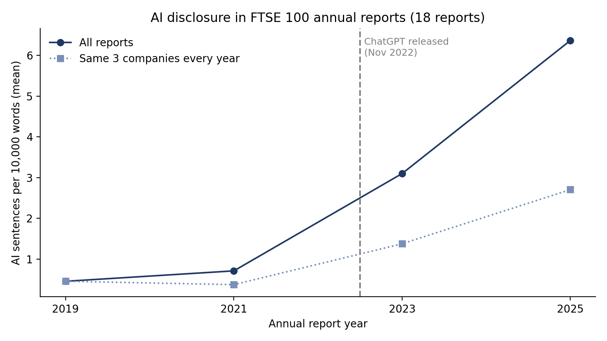

# AI Disclosure in UK Annual Reports: Pilot Study

Pilot analysis for my PhD proposal *Talking AI or Walking AI? Artificial Intelligence Disclosure, AI Washing and Financial Reporting Quality in UK Annual Reports*.

The notebook measures how often UK annual reports discuss artificial intelligence, and how much of that discussion is specific rather than generic, before and after the release of ChatGPT in November 2022.

## What the notebook does

1. Downloads FTSE 100 annual reports (2019, 2021, 2023, 2025) from company and archive websites.
2. Extracts the text from each PDF and fixes broken ligature characters.
3. Finds AI-related sentences using a term list.
4. Labels each AI sentence as specific or generic with a simple rule.
5. Summarises results by company and year and draws a chart.

Run it in Google Colab: open `AI_disclosure_pilot.ipynb`, then Runtime > Run all.

## Pilot results

18 reports from six non-financial FTSE 100 companies were downloaded and analysed (some company websites block automated downloads).

| AI sentences per 10,000 words | 2019 | 2021 | 2023 | 2025 |
| --- | --- | --- | --- | --- |
| AstraZeneca | 1.00 | 0.69 | 2.47 | 4.47 |
| BT Group | 0.09 | 0.42 | 1.36 | 2.58 |
| Diageo | 0.26 | 0.00 | 0.29 | 1.07 |
| Mean, same three firms | 0.45 | 0.37 | 1.37 | 2.70 |
| RELX | | 1.72 | 7.33 | 10.25 |
| Sage | | | 6.51 | 13.47 |
| Rolls-Royce | | | 0.63 | |

- AI discussion rose to about six times its 2019 level by 2025 for firms observed in every year.
- 297 of 886 AI sentences (34%) met the rule for specific disclosure.
- A manual check of 40 random sentences found 39 genuinely about AI; the specific or generic rule agreed with manual judgement in 31 of 40.

## Files

| File | Contents |
| --- | --- |
| AI_disclosure_pilot.ipynb | The full analysis notebook |
| by_report.csv | Results for each report |
| by_year.csv | Results by year, all reports |
| by_year_balanced.csv | Results by year, firms observed in every year |
| download_log.csv | Which reports downloaded and from where |
| ai_disclosure_chart.png | Chart of AI disclosure by year |

## Limitations

This is a small, descriptive pilot. The specific or generic label is rule-based; the PhD replaces it with a fine-tuned FinBERT classifier explained with SHAP values. The code was developed with AI-assisted coding and run, tested and checked by the author.

Author: Mohammad Rehan Akhtar Ansari
